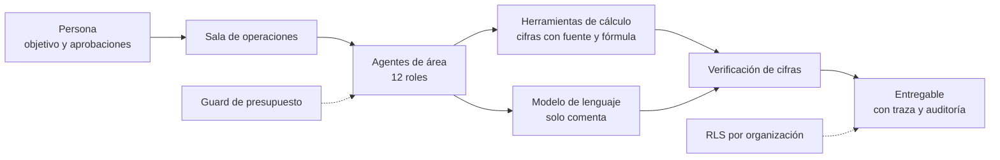

# Oficina Virtual

Oficina virtual para agentes de inteligencia artificial del **Sistema Integral de Gestión Financiera (SIGF)**. Los agentes son los trabajadores: calculan, verifican y comentan; las personas fijan objetivos, aprueban y supervisan.

| | |
|---|---|
| **Estado** | En desarrollo. Funciona solo con **datos sintéticos** |
| **Stack** | Next.js 16 (App Router), React 19, TypeScript estricto, PostgreSQL con Drizzle, Supabase Auth |
| **Idiomas** | Español e inglés (`next-intl`) |
| **Despliegue** | Vercel y Supabase, en sus planes gratuitos |
| **Pruebas** | Vitest, pruebas de integración con PGlite, axe (accesibilidad) y Lighthouse (rendimiento) |

## Qué hace

- **12 agentes de área** organizados en Dirección, Gestión financiera, Rentas y Control y datos. Cada uno tiene herramientas permitidas y reglas que verifica (ver [`docs/agentes-area.md`](docs/agentes-area.md)).
- **Sala de operaciones**: una operación pasa por varios agentes con traspasos en vivo. Cada paso queda registrado en una traza con secuencia propia.
- **Cifras verificadas**: toda cifra la calcula una herramienta de código, nunca el modelo. El comentario del modelo se contrasta con las cifras y las no verificadas se marcan como tales.
- **Estados honestos**: un agente puede quedar *sin datos*, *esperando* (pausado por presupuesto) o *degradado* (terminó con sus tablas, pero el modelo no produjo comentario).
- **Presupuestos y aprobaciones**: tope de tokens, costo e iteraciones por agente, proyecto y organización. Las acciones de riesgo alto piden aprobación humana.
- **Documentos y dashboards** por proyecto, con versiones inmutables.



## Inicio rápido

Requiere Node.js 22.

```bash
npm ci
npm run dev
```

Abra <http://localhost:3000>. Sin variables de entorno, la aplicación usa memoria, autenticación de desarrollo, datos sintéticos y un modelo simulado, así que no necesita cuentas externas.

Para conectar Supabase, un modelo de nube o Ollama, copie `.env.example` a `.env.local` y siga la guía de [`docs/despliegue.md`](docs/despliegue.md).

## Comandos

| Comando | Para qué |
|---|---|
| `npm run dev` | Servidor de desarrollo |
| `npm run build` y `npm start` | Compilar y ejecutar en modo producción |
| `npm run lint` | ESLint |
| `npm run typecheck` | TypeScript sin emitir archivos |
| `npm test` | Todas las pruebas (Vitest) |
| `npm run audit:a11y` | Accesibilidad con axe, en tema claro y oscuro |
| `npm run audit:perf` | Rendimiento con Lighthouse |
| `npm run db:generate` | Genera migraciones de Drizzle |
| `npm run db:migrar` | Aplica las migraciones (`-- --simular` solo muestra el orden) |

La verificación automática de GitHub ejecuta lint, tipos, pruebas, compilación y las dos auditorías en cada cambio.

## Datos y modelos

La regla central es que **ningún dato real sale de la máquina local**.

| Origen del modelo | Valor de `MODELO` | Datos permitidos |
|---|---|---|
| Ninguno o simulado | sin definir | Sintéticos |
| Vercel AI Gateway | `gateway:<proveedor/modelo>` | Solo sintéticos |
| Google AI Studio directo | `google:<modelo>` | Solo sintéticos |
| Ollama en su equipo | `MODELO_LOCAL=ollama:<modelo>` | Sintéticos o reales, con la fuente declarada como real |

En Vercel, una configuración de datos reales falla al construir el servicio y al iniciar cada consulta. Detalles en [`docs/modelo-nube.md`](docs/modelo-nube.md) y [`docs/modelo-local.md`](docs/modelo-local.md).

## Seguridad

- Inicio de sesión con Supabase Auth, lista de correos permitidos y **MFA TOTP** obligatorio.
- Aislamiento por organización con **RLS** de PostgreSQL; la organización sale de la membresía, nunca del navegador.
- Auditoría **append-only encadenada con HMAC**.
- Política de seguridad de contenido (CSP) y cabeceras de seguridad estrictas.
- Las salidas de herramientas y documentos se tratan como datos no confiables, nunca como instrucciones.
- Los secretos se guardan en variables de entorno. `.env.local` y `.vercel` están en `.gitignore`; el repositorio solo incluye `.env.example` con marcadores.

Modelo de amenazas y detalles en [`docs/autenticacion.md`](docs/autenticacion.md).

## Estructura

```
src/
├── app/                 rutas, páginas y APIs (agents, approvals, dashboards, documents,
│                        mantenimiento, operaciones, projects, salud)
├── core/                auth, rbac, i18n, auditoría, presupuesto, base de datos, datos
├── modules/             proyectos, documentos, dashboards, operaciones, agentes de área,
│                        finanzas (rentas, contable, pagos, dirección), interfaz de la sala
├── orchestration/       runtime de modelos, skills, traza y guards
└── components/          componentes de interfaz
tests/                   unit, integration (PGlite) y e2e
scripts/                 migraciones, alta de organización y auditorías
docs/                    documentación técnica
messages/                textos es/en
```

## Documentación

Índice completo y ruta de lectura en [`docs/README.md`](docs/README.md).

| Documento | Contenido |
|---|---|
| [`docs/decisiones/`](docs/decisiones/README.md) | Decisiones de arquitectura y sus razones |
| [`docs/arquitectura.md`](docs/arquitectura.md) | Esquema de datos, runtime de agentes, flujo y etapas |
| [`docs/estructura.md`](docs/estructura.md) | Diagramas por capas, árbol del repositorio, recorrido de una operación y estados |
| [`docs/vista-previa/oficina-virtual.html`](docs/vista-previa/oficina-virtual.html) | Simulación interactiva con datos ficticios (abrir en el navegador) |
| [`docs/agentes-area.md`](docs/agentes-area.md) | Los 12 agentes, herramientas y reglas de negocio |
| [`docs/autenticacion.md`](docs/autenticacion.md) | Sesión, MFA, roles y modelo de amenazas |
| [`docs/persistencia.md`](docs/persistencia.md) | PostgreSQL, roles, RLS, migraciones y retención |
| [`docs/modelo-nube.md`](docs/modelo-nube.md) | AI Gateway y Gemini directo |
| [`docs/modelo-local.md`](docs/modelo-local.md) | Ollama |
| [`docs/despliegue.md`](docs/despliegue.md) | Supabase y Vercel paso a paso, con el inventario de variables |

## Aviso de uso

Repositorio privado, sin licencia de código abierto. Ver [`AVISO.md`](AVISO.md). Para contribuir, [`CONTRIBUTING.md`](CONTRIBUTING.md); qué no subir, [`SEGURIDAD.md`](SEGURIDAD.md).

## Historial de cambios

Ver [`CHANGELOG.md`](CHANGELOG.md).
