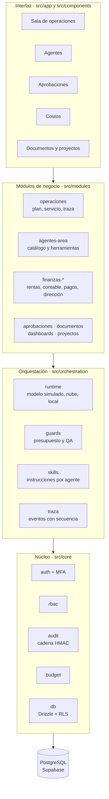
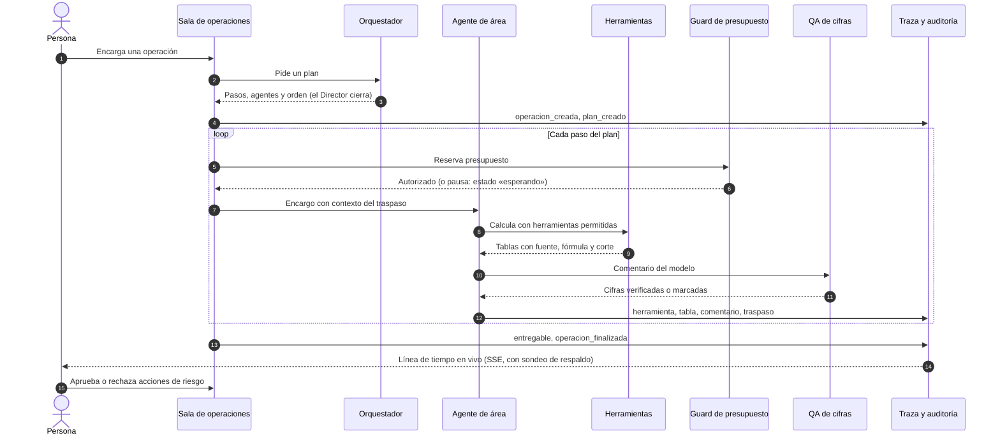
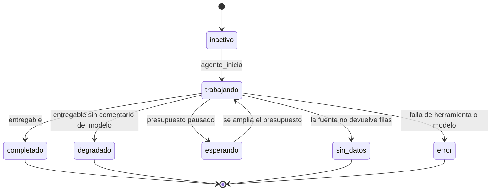
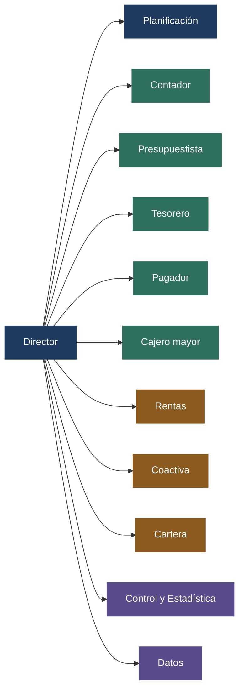

# Estructura y flujo de la Oficina Virtual

Este documento muestra cómo está organizado el código y cómo viaja una operación por la Sala de operaciones. Complementa a [`arquitectura.md`](arquitectura.md), que explica las decisiones, y a [`agentes-area.md`](agentes-area.md), que define cada agente.

## Vista por capas



La dependencia va siempre hacia abajo: la interfaz llama a los módulos, los módulos usan la orquestación y todos se apoyan en el núcleo. El núcleo no conoce a los agentes.

## Árbol del repositorio

```text
oficina-virtual/
├── src/
│   ├── app/                         rutas y APIs (Next.js App Router)
│   │   ├── [locale]/
│   │   │   ├── login/ · seguridad/  acceso, MFA, sin acceso
│   │   │   └── (oficina)/           operaciones · agentes · aprobaciones
│   │   │                            costos · documentos · proyectos · finanzas
│   │   └── api/                     operaciones · agents · approvals · projects
│   │                                documents · dashboards · mantenimiento · salud
│   ├── core/                        auth · rbac · audit · budget · db · i18n · datos
│   ├── modules/
│   │   ├── agentes-area/            catálogo de 12 agentes y sus herramientas
│   │   ├── operaciones/             plan, servicio y fábrica de la operación
│   │   ├── operaciones-ui/          estado visible de cada agente y del grafo
│   │   ├── finanzas-{rentas,contable,pagos,direccion}/   cálculos por área
│   │   └── aprobaciones · documentos · dashboards · proyectos · mantenimiento
│   ├── orchestration/
│   │   ├── runtime/                 modelo simulado, nube (Gateway, Google) y Ollama
│   │   ├── guards/                  presupuesto y control de calidad (QA)
│   │   ├── skills/                  una instrucción en Markdown por agente
│   │   └── traza/                   EventoTraza: contrato entre servicio e interfaz
│   └── components/                  componentes de interfaz
├── tests/                           unit · integration (PGlite) · e2e
├── scripts/                         migrar · alta-organizacion · audit-a11y · audit-perf
├── docs/                            arquitectura · agentes · autenticación · despliegue …
├── messages/                        textos es / en
└── .github/workflows/ci.yml         lint, tipos, pruebas, build, a11y y rendimiento
```

## Recorrido de una operación



## Estados de un agente



## Equipo de 12 agentes



El Director consolida el entregable al final de toda cadena. Los demás agentes se traspasan el trabajo entre sí según el plan; las reglas de cada uno están en [`agentes-area.md`](agentes-area.md).

## Vista previa interactiva

[`vista-previa/oficina-virtual.html`](vista-previa/oficina-virtual.html) es una página autónoma, sin dependencias, que simula una operación con **datos ficticios**: se puede elegir un encargo, ver los traspasos entre agentes, los estados y la traza. Solo ilustra el flujo; no ejecuta el sistema.
